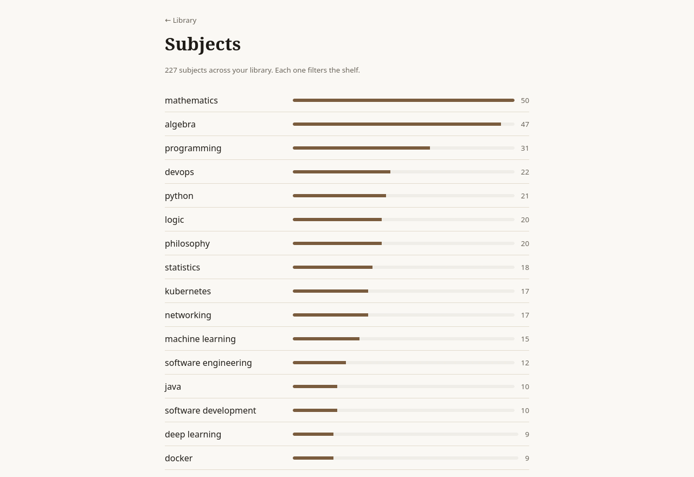
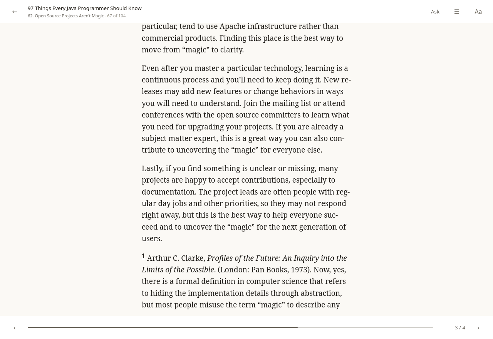
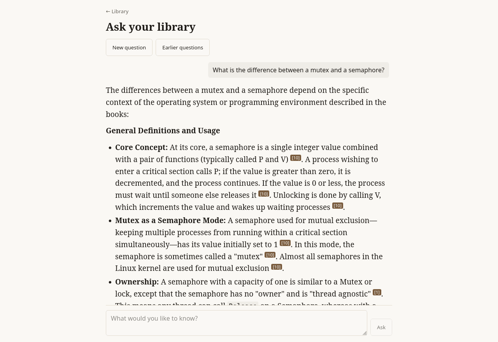

# Lexarii

Self-hosted ebook library, reader, and research assistant. Your books, your reader, **your** model.

Lexarii scans a folder of ebooks, builds a proper library out of it, gives you a reading experience that feels like a book rather than a web page, and — if you point it at a local llama.cpp instance — tags and summarises your books automatically and lets you ask questions across your whole collection with real citations back into the text.

> **Status: pre-alpha.** Foundations only. See [docs/ROADMAP.md](docs/ROADMAP.md).


## What it is

- **A library.** EPUB and PDF, scanned from a read-only folder. Works, editions, authors, series, collections, tags. Comics and Kindle formats are shelved but [not yet readable](#what-does-not-work-yet).
- **A reader.** Paginated, typographically serious, offline-capable, themed, mobile-first.
- **A research assistant.** Optional. Local-model enrichment and RAG-backed chat that cites the exact passage and links you straight to it in the reader.
- **An OPDS catalogue.** Every reader app already speaks it - KOReader, Librera, Thorium, Foliate - so the library opens on a phone or an e-ink reader today, without waiting for a client of ours. Point the app at `http://your-server:8080/opds`.
- **Free software.** No telemetry, no accounts you do not own, no proprietary dependencies. An Android client for F-Droid is planned.

Subjects come out of the books themselves rather than being typed in, so a collection that grew by accident still has a shape to browse:



The reader paginates properly — columns, not a scrolling wall — and remembers where you were:



Every answer cites the passage it came from, and each citation links straight back into that book at that point:



## What it is not

It is not a cloud service, it does not phone home, and it will never write to your book files.

## What does not work yet

Pre-alpha means pre-alpha. These are the things people notice first, so they are here rather than in an issue tracker:

- **Only EPUB and PDF can be read.** MOBI, AZW3, CBZ and CBR are recognised, shelved, and counted - they are library citizens - but the reader cannot open them and their text is never extracted, so search and the assistant do not see them.
- **Scanned PDFs are shelved, not searched.** A PDF with no text layer is detected, marked `needs_ocr`, and stays readable as page images. Lexarii does not run OCR, so those books are invisible to search, to retrieval, and to every answer.
- **DRM-protected books are not supported and will not be.** An encrypted PDF is reported as encrypted rather than silently failing.
- **A book with no title stays "Untitled".** Publisher metadata beats a guess, and a filename recorded as fact would outrank the truth forever, so Lexarii refuses to invent one. With a model configured, enrichment reads the title off the title page and fills it in - which is most of what enrichment is for.
- **There is no Android client yet.** Reading on a phone means an OPDS reader app pointed at this server, which works now. The rest of M6 and M7 - citation export, catalogue lookup, importing a PDF's own highlights, offline sync - is [done](docs/ROADMAP.md); a PDF's highlights are read out and never written back, because the library folder is read-only.
- **A book's own highlights come in, and do not go back out.** Imported from the PDF, kept here, never written into your file.
- **One machine, one process.** There is no clustering and no read-replica support, and none is planned for v0.1.

The assistant's own accuracy is measured rather than asserted: on a 173-book library and 37 questions it finds the right book in the top ten 89% of the time. It is a research assistant, not an oracle, and it is built to say the library does not contain an answer rather than to produce one anyway.

## Getting books in

Two ways, and you can use both at once:

- **Point it at a folder.** `LEXARII_LIBRARY_DIR` is scanned and **never written to**. Best for a collection you already keep on disk, and for a first import of thousands of books over rsync or Syncthing.
- **Upload them.** `POST /api/v1/uploads` takes a bulk multipart upload; processing happens on the server. Files land in `LEXARII_UPLOAD_DIR`, which Lexarii owns - never in your library directory, and startup refuses a configuration that mixes the two.

Uploads are deduplicated by content, so if a large batch is interrupted the fix is simply to upload it again: what already arrived is recognised and skipped. Over the internet a very large batch may not survive the trip, and re-uploading is the supported recovery rather than a workaround.

**Who may upload** is `LEXARII_UPLOAD_POLICY`: `admins` (the default) or `users`. With `users`, everybody with an account adds books to their own shelf - the setting for a family or a club where each person brings their own. A book is its uploader's and nobody else sees it until they lend it. Two people who upload the same file each get it on their own shelf, under their own filename; it is stored and indexed once, and the reply to an upload never says that somebody else already had it. `LEXARII_MAX_UPLOAD_MB` caps every file either way, and scanning, enrichment and indexing stay with administrators. There is no per-person storage quota yet, so open uploading to people you would trust with the disk.

**Who may see who else is here** is `LEXARII_PEOPLE_DIRECTORY`: `all` (the default) lists every account's username to anybody signed in, which is what the share picker offers to lend a book to. `none` lists accounts to administrators only; everybody else lends a book, or shares their notes, by typing the recipient's exact username. A name that does not exist is answered plainly as not found: lending by name cannot hide which names exist, so `none` stops handing out the list, but somebody signed in who guesses a username can still learn that it is one.

**What happens to a deleted account's books** is `LEXARII_DELETED_ACCOUNT_FILES`: `archive` (the default) keeps the books only that person held, marked with their name, for an administrator to hand on. `erase` deletes them with the account - the record, its passages and cover, everybody's notes on it, and the copies Lexarii stored - for an installation that must not keep what a person added after they leave. Nothing in the library directory is ever deleted. A book somebody else also holds just loses a holder either way. An administrator can also erase one person's books without deleting the account (`POST /api/v1/admin/users/{id}/erase-files`), for a retention rule that reaches the books first.

## Security posture, stated plainly

Lexarii has accounts. The first time you open it you create one, and it becomes the administrator; every API endpoint refuses unauthenticated requests. Passwords are hashed with argon2id, and session tokens are stored only as hashes, so a database backup cannot be replayed as a login.

Session cookies are marked `Secure` by default. If you run Lexarii over plain HTTP on a trusted network you must set `LEXARII_SECURE_COOKIES=false`, and the server will warn you on every start that it did.

Sign-in is rate limited by username and source address together.

Lexarii does not run your sign-ups or password resets for you, but it can point at whatever does: `LEXARII_SIGNIN_LINKS` puts your own links under the sign-in form - "Request access", "Forgot password?", the house rules. It is a JSON array of `{"label","href"}`; each href must be a path on this server or an `https://` URL, and anything else stops the server at startup.

The sign-in page can carry your own look - logo, colours, a background - without a fork: point `LEXARII_BRANDING_DIR` at a directory with a `branding.css` and the files it uses. The supported hooks and design tokens are in [docs/BRANDING.md](docs/BRANDING.md).

**Single sign-on** works today via OpenID Connect - set `LEXARII_OIDC_ISSUER` and `LEXARII_OIDC_CLIENT_ID` and it appears on the sign-in screen. Local passwords keep working alongside it, so a misconfigured issuer cannot lock you out. Account creation on first sign-in is off by default: against a public issuer it would let anyone with an account there into your library.

**LDAP and Active Directory** work too - set `LEXARII_LDAP_URL` and a base DN, add `LEXARII_LDAP_ACTIVE_DIRECTORY=true` for AD. Lexarii authenticates by binding to the directory *as you*: it never reads, compares, or stores your directory password. `LEXARII_LDAP_REQUIRED_GROUP` restricts access when the directory serves more people than should have a library.

**Reverse-proxy SSO** works if you already run oauth2-proxy, Authelia, Authentik, or a corporate gateway: set `LEXARII_PROXY_USER_HEADER` and `LEXARII_PROXY_TRUSTED`. The trusted-address list is mandatory and Lexarii refuses to start without it — a header is only a credential because of where it came from, and without that check anyone who can reach the port could claim to be anyone.

All of these can run at once, and local passwords always remain available, so a misconfigured provider cannot lock you out.

Book content is treated as hostile throughout: EPUB HTML is sanitised against an allowlist before it reaches the DOM, publisher stylesheets are discarded entirely, remote images are blocked rather than fetched, and only image files are served back out of a book archive.

## Design commitments

1. Your library directory is mounted **read-only**. Derived data lives elsewhere.
2. Reading positions are stable locators, not scroll percentages — they survive font changes, rotation, and re-ingest.
3. The model is **optional**. With it switched off, the library and reader work completely.
4. Publisher metadata always beats a model's guess, and every AI-written field shows its provenance so you can reject it.
5. Answers cite their sources, or say the library does not contain one.

## Requirements

- Postgres 18 with the `vector` extension (the compose file handles this)
- Optional: any OpenAI-compatible model server — llama.cpp, Ollama, vLLM, LM Studio, or a hosted one — for enrichment and chat
- Optional: a cross-encoder for [reranking](#reranking-and-why-it-is-a-separate-model), which is a different model from the chat one
- Go 1.25+ and Node 22+ only if building from source

## Quick start

With Docker, which is the shortest path to a running library:

```bash
cp .env.example .env    # point LEXARII_LIBRARY_DIR at your books, and
                        # set POSTGRES_PASSWORD (openssl rand -hex 24)
docker compose --profile full up
```

The database password has no default, and compose stops with a message naming
it until `.env` has one: a password written into a public compose file is one
every reader of it knows. Postgres takes it when its volume is first created
and keeps it from then on. Its port is published on 127.0.0.1 only - the
server reaches it over the compose network and needs no port at all.

Then open <http://localhost:8080> and create the first account. That account is
the administrator, and the form is only offered while the database has no users
in it - so do it before the machine is reachable from anywhere else.

Your library folder is mounted **read-only**; everything Lexarii derives -
covers, extracted text, uploads - goes in a Docker volume. The schema is
applied at startup, so there is no migration step to remember.

That pulls a published image from `scm.poniatowski.dev/adam/lexarii`. To run
a particular build instead of the newest one, name it:

```bash
LEXARII_IMAGE=scm.poniatowski.dev/adam/lexarii:3ebd2d8 docker compose --profile full up
```

and to build from this checkout rather than pulling anything, `docker compose
--profile full up --build`.

Plain `docker compose up` starts Postgres alone, which is what you want if you
are running the server from a checkout:

```bash
cp .env.example .env    # and set POSTGRES_PASSWORD
make db-up              # postgres with pgvector
make dev                # server on :8080, client on :5173
```

A development database created before the password became required has the
password `lexarii`: put that in `.env` as `POSTGRES_PASSWORD`, or change it with
`ALTER ROLE lexarii PASSWORD '...'`. The Makefile hands it to psql, goose and the
tests as `PGPASSWORD`, so its URLs carry no password.

`make dev` migrates too. `make migrate-up` is still there for applying the
schema without starting anything, and `LEXARII_AUTO_MIGRATE=false` turns the
startup migration off for an operator who would rather run it themselves.

Connecting a local model, using llama.cpp:

```bash
# chat
./llama-server -m qwen3-8b-instruct.gguf --host 0.0.0.0 --port 8081

# embeddings (a second server, usually a much smaller model)
./llama-server -m nomic-embed-text-v1.5.gguf --embeddings --host 0.0.0.0 --port 8082
```

Then set `LEXARII_LLM_BASE_URL` and `LEXARII_EMBED_BASE_URL` in `.env`. `GET /api/v1/health` answers `ok`, `degraded` or `down` to anyone; signed in as an administrator it also reports the database and each model server separately, so you can see exactly which leg is down.

Any OpenAI-compatible endpoint works for those two, hosted ones included — Groq, OpenAI, Anthropic through a compatible gateway, or another machine on your network. Nothing about the library or the reader needs a model at all; only enrichment and chat do.

Books are made searchable when an administrator asks (the index action, `POST /api/v1/index`). Set `LEXARII_INDEX_ON_INGEST=true` to have every new book chunked as it arrives, by upload or by scan, with embedding following whenever the embedding server is up. It is off by default because embedding a first scan of a large library is a lot of GPU time.

Books are described by the model - subjects, a summary, suggested metadata - when an administrator asks (`POST /api/v1/enrich`). Set `LEXARII_ENRICH_ON_INGEST=true` to have every new book described as it arrives instead; the job belongs to whoever added the book, who can follow it. It does nothing without a chat model configured, and it is off by default for the same reason as indexing: it is model time for every book.

## Reranking, and why it is a separate model

**Optional, off by default, and worth understanding before you turn it on.**

Retrieval matches a question against a passage without ever asking whether the passage *answers* it. A contents page listing "Eigenvalues and Eigenvectors" matches a question about eigenvalues on every signal an index has, and answers nothing. A reranker is the stage that can tell those apart.

It has to be a **cross-encoder** — a model that reads the question and one passage *together* and scores the pair. That is a different kind of model from the one that writes answers, and the difference is not academic. All three columns are measured on the same 173-book library and the same 37 questions:

| | no reranking | chat model reranking | **cross-encoder** |
|---|---|---|---|
| work Recall@10 | 0.892 | 0.811 | 0.892 |
| work MRR | 0.748 | 0.722 | **0.806** |
| passage Recall@10 | 0.625 | 0.625 | **0.688** |
| passage MRR | 0.434 | 0.444 | **0.514** |
| median question | 1.6s | 6.8s | 2.1s |

The chat model made retrieval worse and four times slower, so that approach was removed rather than left as an option — a decoder asked to rank is doing a job it was not trained for, and no prompt fixes it. A cross-encoder ranks the right passage materially higher for half a second, which is what the stage was always for.

The model measured here is `bge-reranker-v2-m3` at Q8_0 — 0.6B parameters, 636MB — sharing a 12GB RTX 3060 with the chat and embedding models.

**Read the quality columns, not the clock.** Recall and MRR are properties of the models and the library; they will look much the same on your hardware. The latencies are not: they are one consumer GPU serving three models at once, and a hosted endpoint or a bigger card will be faster. What travels is the shape — reranking twenty passages costs a few hundred milliseconds against a second or more of retrieval and several seconds of generation, so it is a small part of what somebody waits for.

Scoring twenty full-length passages measures 280–360ms on that card. The model is under a gigabyte of VRAM, so it sits beside a chat model comfortably; if the card is full, `--n-gpu-layers 0` puts it on the CPU, which costs latency rather than quality.

### Running one yourself

llama.cpp serves cross-encoders. All three flags are required and they work together — `--reranking` exposes the endpoint, `--embedding` puts the server in the right mode for it, and `--pooling rank` makes it return scores rather than vectors:

```bash
llama-server -hf gpustack/bge-reranker-v2-m3-GGUF:Q8_0 \
  --host 127.0.0.1 --port 8083 \
  --embedding --pooling rank --reranking
```

```bash
LEXARII_RERANK_BASE_URL=http://127.0.0.1:8083/v1
LEXARII_RERANK_MODEL=bge-reranker-v2-m3
```

636MB at Q8_0 and under a gigabyte of VRAM, so it sits beside a chat model on the same card rather than needing one of its own. `--n-gpu-layers 0` keeps it on the CPU if the card is full.

If your models live on a separate machine, as they often do, serve it with `--host 0.0.0.0` and point the URL at that host. `llama-server` has no authentication of its own, so that belongs on a trusted network or behind a firewall, on the same footing as the chat and embedding servers beside it.

[deploy/systemd/llama-reranker.service](deploy/systemd/llama-reranker.service) is a unit for exactly that, shaped like an embedding server so it sits alongside the ones a model host already runs.

One line in it does more than it looks like it does. With `DynamicUser` and `ProtectHome` there is no home directory for `-hf` to download into, so `LLAMA_CACHE` has to point at a writable `StateDirectory` — otherwise the first start stalls with nowhere to put the file, and every restart fetches 636MB again.

**Check the GGUF.** Several published conversions of reranker models were made without the model's classification head. They load, they serve, and they return a score of about `1e-28` for every passage — nothing errors, and the ranking is noise. Lexarii refuses scores that cannot order anything, keeps the retrieved order, and says so in the log. If you see that, the conversion is the problem.

### Using a hosted one

The request shape is the one Jina and Cohere established, so these work by pointing at them:

| Provider | `LEXARII_RERANK_BASE_URL` |
|---|---|
| Jina | `https://api.jina.ai/v1` |
| Cohere | `https://api.cohere.com/v2` |
| Voyage | `https://api.voyageai.com/v1` |

**Groq, OpenAI and Anthropic do not offer reranking.** There is no rerank endpoint on any of them — they serve chat and, in OpenAI's case, embeddings. If one of them is your chat model that is fine and unaffected; reranking is a separate endpoint and you can leave it unset, or point it at one of the three above, or run a local one. What you cannot do is have your chat provider rerank, because that is the approach measured in the table above.

### Decide with your own numbers

Whatever you point it at, measure it rather than trusting it:

```bash
make eval    # compares against eval/baseline.json
```

A reranker that does not beat the baseline is costing you latency for nothing. `eval/baseline.json` is this library with reranking; `eval/baseline-no-rerank.json` is the same questions without it, so the comparison is one command either way:

```bash
go run ./scripts/eval -rerank=false -compare eval/baseline.json
```

One thing worth knowing before you tune anything: how much of each passage the reranker sees matters more than it sounds. Lexarii sends up to 2,048 characters, which reaches all of nearly every chunk. Sending half of each passage instead measured *worse than not reranking at all* — the model scored what it was shown, and what it was shown was half an answer.

## Reading on a phone or an e-reader

Point any OPDS reader at:

```
http://your-server:8080/opds
```

Sign in with your username, and — preferably — a **device token** as the password rather than your account password. A token is made for one device, shows up under that name in **Account → Signed-in devices**, and can be revoked on its own without changing your password or signing out anything else:

```bash
curl -s -X POST http://your-server:8080/api/v1/auth/token \
  -H 'Content-Type: application/json' \
  -d '{"username":"you","password":"your-password","device":"KOReader on the Kobo"}'
```

The token comes back once. Paste it into the reader's password box.

Your own password works too, and a reader app stores it in cleartext on the device, which is the reason for the token.

Tested against the catalogue as readers actually use it: browse, page, search, download. Books are offered in the best format the server holds for you, one file per book; a book whose drive is unmounted is listed by neither.

## Citations

Every book exports as a citation, in the three formats the tools people use disagree about:

| Format | For |
|---|---|
| BibTeX | LaTeX and BibLaTeX |
| RIS | Zotero, Mendeley, EndNote |
| CSL-JSON | Pandoc and most modern tools |

`GET /api/v1/works/{id}/citation?format=bibtex`, or there are three links on every book's page. A whole shelf at once is `GET /api/v1/citations?tag=distributed-systems&format=ris` — the same filters as the library listing, so a bibliography for a subject is one request.

Nothing is looked up or guessed. A field the library does not have is left out, because a citation with an invented year gets pasted into somebody's bibliography and read as a fact. Set `LEXARII_PUBLIC_URL` if you want a link back to the book in the citation; without it the field is omitted rather than pointing at `localhost`.

## Filling in publishers and years

Most PDFs carry no publisher and no year, which makes for a thin citation. `make metadata` says which books are missing them, and `make metadata ARGS=-apply` looks them up.

**This is the only part of Lexarii that talks to anything outside your machine, and it is off until you configure it.** A lookup sends a title and an author, or an ISBN, to whatever `LEXARII_METADATA_BASE_URL` names — one request per book, a second apart. That is a description of your shelf leaving your network, so:

- it does nothing at all unless you set that variable — `https://openlibrary.org` is the obvious choice, and OpenLibrary can be self-hosted if you would rather it were your own server
- `make metadata` with no flags sends nothing and only reports
- it fills **empty** fields only. What your file already said is what the publisher wrote; a catalogue is a third party describing what may be a different printing
- every value it writes is recorded as `external` provenance, so the book's page can say where it came from and you can reject it

Measured on a 168-book library: OpenLibrary knew about roughly a third of the technical books, and filled in a publisher, a year, both ISBNs and a page count for each of those.

## Documentation

| Document | What is in it |
|---|---|
| [docs/DOMAIN.md](docs/DOMAIN.md) | The vocabulary. Work vs Edition vs BookFile, Locators, Chunks, Jobs. Read this first. |
| [docs/ARCHITECTURE.md](docs/ARCHITECTURE.md) | Layering, the ingest pipeline, the retrieval pipeline, and the decisions behind them. |
| [docs/ROADMAP.md](docs/ROADMAP.md) | Milestones in dependency order, with exit criteria. |
| [docs/UPGRADING.md](docs/UPGRADING.md) | What changes when an existing installation upgrades, and how to go back. Read it before upgrading. |
| [deploy/systemd](deploy/systemd) | Units for Lexarii and for the optional reranker, with the hardening explained. |

## Licence

**GNU AGPL-3.0-or-later.** See [LICENSE](LICENSE) and [NOTICE](NOTICE).

Copyleft with the network clause, deliberately. Lexarii is server software, and
plain GPL would let someone run a modified, closed version as a hosted service
without ever publishing the changes. AGPL closes that. Anyone may use, modify,
self-host, and redistribute it; anyone who offers it to others has to pass the
same freedoms on.

Every dependency must be AGPL-compatible free software, and anything reaching a
client must additionally satisfy F-Droid's rules — no proprietary libraries, no
Google Play Services, reproducible from source.
